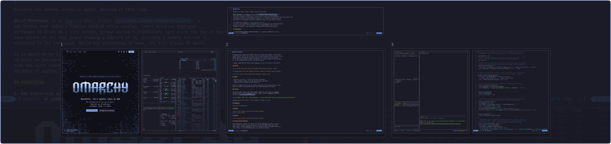

# Which Workspace

An Omarchy shell plugin that answers "where did I leave that window?". A bar button
opens a Mission Control style overlay: every occupied workspace drawn as a tiny screen,
spread across a translucent card along the top of the screen, with each window
in its real tiled position showing a snapshot of it. Click a window to jump straight
to it: its workspace comes up with that window focused.



> **Status: early (0.1.2).** Tested on Omarchy 4.5 (Quickshell 0.3.2) with one monitor.

## Install

```bash
omarchy plugin add https://github.com/namlet/omarchy-which-workspace --enable
```

The button goes in the left section of the bar. Drag it, or move it from a terminal:

```bash
omarchy bar move io.github.namlet.which-workspace --section right
```

## Usage

- Click the bar button, or press your hotkey (see below).
- Click a window to focus it. Or use the arrow keys and Enter.
- Escape or a click outside the card closes it.

Tiles are numbered the way the bar numbers workspaces. The scratchpad shows up only
while it's down: hit its hotkey and its tile slides down above the others.

### Hotkey

The plugin doesn't bind a key itself. Super + Ctrl + Up works well (it's macOS's
Mission Control key with Omarchy's modifier, and it's free in Omarchy's defaults).
Add this to `~/.config/hypr/bindings.lua`:

```lua
o.bind("SUPER + CTRL + UP", "Which Workspace", "omarchy-shell shell toggle io.github.namlet.which-workspace")
```

Hyprland picks it up on save. Press it again, or Escape, to close.

## Configure

There are no settings yet.

## Update

```bash
omarchy plugin update io.github.namlet.which-workspace
omarchy restart shell
```

## Remove

```bash
omarchy plugin remove io.github.namlet.which-workspace
```

## Privacy and permissions

Reads Hyprland's workspace and window list through Quickshell's built-in service,
takes a still snapshot of each window when the overlay opens (shown only there,
never saved), and asks Hyprland to focus the window you pick. No network access, no
files written, no external dependencies, no elevated privileges.

## Development

Requires `nodejs`, `make` and `qt6-declarative` (all in the Arch repos).

```bash
make test       # Node tests for Model.js, headless QML tests for components/, lint
make validate   # omarchy plugin validate (needs an Omarchy install)
make preview    # the overlay with made-up windows; PNG=out.png saves a picture
```

The entry point can only be exercised inside the running shell. See the manual smoke
test in [AGENTS.md](AGENTS.md), which also covers branches and contribution rules.

## License

[MIT](LICENSE)
